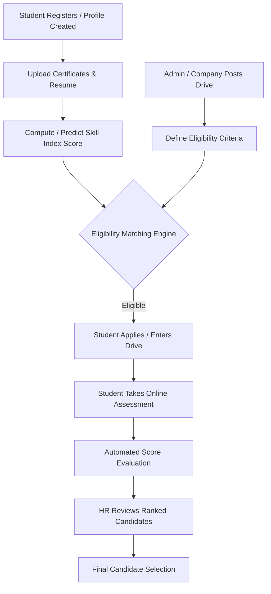

# SMART RECRUITMENT AND AI INTERNSHIP ALLOCATION SYSTEM

An intelligent recruitment, internship matching, and talent allocation platform powered by Machine Learning and Flask. The system connects academic institutions, students, and hiring companies into a unified, data-driven internship allocation ecosystem.

---

## 📌 Problem Statement

Traditional campus recruitment and internship allocation processes suffer from several persistent challenges:
- **Manual Filtering Bottlenecks:** Placement cells spend countless administrative hours manually screening resumes, filtering student lists, and verifying academic criteria.
- **Subjective & Static Evaluations:** Candidate evaluations often rely solely on raw CGPA, failing to capture holistic technical capabilities, coding proficiency, domain assessment scores, and verified certifications.
- **Mismatched Placements:** Companies receive large volumes of uncurated applicant profiles that do not match specific skill requirements, while students miss out on government schemes and internship opportunities aligned with their competencies.
- **Lack of Centralized Tracking:** Placement drives, student test assessments, certificate verifications, and drive results are often fragmented across disparate spreadsheets and communication channels.

---

## 💡 Proposed Solution

The **Smart Recruitment and AI Internship Allocation System** addresses these bottlenecks through an integrated multi-portal architecture coupled with Machine Learning-based evaluation:
1. **Multi-Portal Collaboration:** Dedicated portals for Administrators, Students, and Corporate Recruiters operating in harmony.
2. **Skill Index Score (SIS):** A machine learning model that predicts an objective, multi-dimensional Skill Index Score based on academic standing, verified certifications, test performances, and domain skills.
3. **Automated Scheme & Opportunity Recommendation:** Content-based and machine-learning-driven matching of students with government initiatives, specialized internship schemes, and company drives.
4. **End-to-End Recruitment Management:** From drive scheduling and automated student eligibility filtering to online assessment tests and candidate selection.

---

## 🚀 Main Features

- **Automated Resume & Certificate Processing:** Ingests student certificates (PDF/image) and resume files, mapping accomplishments to student records.
- **Dynamic Eligibility Filtering:** Recruiters configure criteria (minimum CGPA, required skills, aptitude/domain cutoffs, allowed backlogs), and the system automatically computes eligible candidate shortlists.
- **Built-in Assessment Testing Engine:** Admin and companies can host aptitude and domain-specific tests with automated evaluation and instant score syncing.
- **Skill Index Prediction Pipeline:** Trained regression pipeline producing a normalized Skill Index Score (SIS) for transparent candidate ranking.
- **Recycle Bin & Data Integrity:** Safe student deletion and restore mechanisms within the admin dashboard to prevent accidental record loss.
- **Multi-Threaded Server Launcher:** Single command startup orchestrating the Gateway, Admin, Student, and Company portals concurrently.

---

## 🏢 Three Portals Architecture

The system provides three role-specific interfaces orchestrated through a central Gateway Portal:

```
                          ┌─────────────────────────────┐
                          │     Main Gateway Portal     │
                          │      http://localhost:5000  │
                          └──────────────┬──────────────┘
                 ┌───────────────────────┼───────────────────────┐
                 │                       │                       │
                 ▼                       ▼                       ▼
  ┌─────────────────────────┐ ┌────────────────────┐ ┌────────────────────────┐
  │      Admin Portal       │ │   Student Portal   │ │     Company Portal     │
  │  http://localhost:5001  │ │ http://localhost:5002│ │ http://localhost:5003 │
  └─────────────────────────┘ └────────────────────┘ └────────────────────────┘
```

### 1. Admin Portal (`port 5001`)
- **Authentication & Security:** Secure admin login with hashed credential verification.
- **Master Student Database:** Upload, browse, search, and update comprehensive student records.
- **Drive Management:** Create and schedule company recruitment drives, configure test requirements, and monitor participation.
- **Assessment Management:** Upload test question banks (aptitude, technical, domain CSVs) and inspect test results.
- **Recycle Bin:** Recover mistakenly deleted student records with full data integrity.

### 2. Student Portal (`port 5002`)
- **Student Authentication:** Secure student login via institutional credentials (roll number, password / date of birth).
- **Profile Dashboard:** Real-time view of academic standing, calculated Skill Index Score, test scores, and profile completeness.
- **Document Management:** Upload course/achievement certificates (PDF/PNG) and generate or upload resumes.
- **Active Drives & Opportunities:** Browse open internship and campus drives matching student eligibility.
- **Integrated Test Center:** Read test instructions, take scheduled aptitude and domain assessments with automated grading.
- **Scheme Recommendations:** Personalized recommendations for internship schemes and training opportunities.

### 3. Company Portal (`port 5003`)
- **HR Authentication & Registration:** Company registration and secure login for recruitment teams.
- **Drive Creation:** Post internship drives specifying role descriptions, required skillsets, CGPA thresholds, assessment cutoffs, and stipends.
- **Candidate Pool Discovery:** View eligible students ranked by academic score and Skill Index Score.
- **Applicant Selection:** Review candidate profiles, certificates, and test results to make final selections.

---

## 🧠 Machine Learning Component

The platform integrates Machine Learning models for candidate evaluation and opportunity matching:

### 1. Skill Index Score (SIS) Regression Pipeline
The core ML pipeline predicts a student's composite Skill Index Score (SIS):
- **Models Evaluated:** Linear Regression, Ridge, Decision Tree, Random Forest, Extra Trees, Gradient Boosting, and **XGBoost Regressor** (tuned via `RandomizedSearchCV`).
- **Best Model:** Tuned **XGBoost Regressor** saved to `models/SkillIndex/best_model.pkl` and `model/skill_index_model_xgb.pkl`.
- **Validation Methodology:** 5-fold cross-validation on 80% training data, evaluated against an unseen 20% test holdout.
- **Benchmark Evaluation Results:**
  - **Test $R^2$ Score:** `0.8511`
  - **Test MAE:** `5.2684`
  - **Test RMSE:** `7.0743`
  - **5-Fold CV $R^2$:** `0.8853 ± 0.0125`
  - **5-Fold CV MAE:** `4.6447`
  - **Training $R^2$:** `0.9422` (Overfitting check passed)
- **Interpretability & Reports:** Full feature importance charts, actual vs. predicted plots, CV score plots, and residual plots are exported to `reports/plots/`.

> **Note on Data:** Production deployments utilize institutional student data stored in `data/master_students.csv`. For reproducible benchmark training and research validation, the pipeline evaluates on the validated benchmark dataset (`v2_improvements/data/synthetic_students.csv`), ensuring clean metric separation between production student records and benchmark evaluations.

### 2. Scheme Recommender
Matches candidate skill profiles and academic status against available internship schemes and specialized government initiatives using content-based matching and feature prediction (`scheme_recommender.py` and `model/scheme_predictor_v2_rf.pkl`).

---

## 🛠 Technology Stack

- **Backend Framework:** Python 3, Flask, Werkzeug
- **Machine Learning & Data Science:** Scikit-learn, XGBoost, Pandas, NumPy, Joblib
- **Document & Text Processing:** pdfplumber, NLTK, spaCy
- **Frontend / UI:** HTML5, CSS3, JavaScript, Jinja2 templating
- **Data Persistence:** Local JSON credential stores (`admins.json`, `company_hr.json`) and structured CSV datastores (`master_students.csv`, `company_drives.csv`, `test_results.csv`, `schemes_final_expanded.csv`)
- **Plotting & Visualization:** Matplotlib, Seaborn

---

## 🔄 Project Workflow



1. **Profile Setup:** Student records are imported or updated with academic scores and uploaded certifications.
2. **Score Computation:** The ML model and evaluation utilities calculate the student's Skill Index Score.
3. **Drive Announcement:** Company recruiters post drives with specific qualification parameters.
4. **Eligibility Filtering:** Students matching criteria appear in eligible candidate shortlists and can register.
5. **Testing & Selection:** Candidates take scheduled tests via the student portal; recruiters review performance and finalize allocations.

---

## 💻 Installation Instructions

### Prerequisites
- Python 3.9+ (tested up to Python 3.14)
- Git

### 1. Clone the Repository
```bash
git clone https://github.com/am24citgokul/SMART-RECRUITMENT-AND-AI-INTERNSHIP-ALLOCATION-SYSTEM.git
cd SMART-RECRUITMENT-AND-AI-INTERNSHIP-ALLOCATION-SYSTEM
```

### 2. Create and Activate Virtual Environment
```bash
# Windows (PowerShell)
python -m venv venv
.\venv\Scripts\Activate.ps1

# Linux / macOS
python3 -m venv venv
source venv/bin/activate
```

### 3. Install Dependencies
```bash
pip install -r requirements.txt
```

---

## ▶ How to Run the Project

### Option A: Launch All Portals Simultaneously (Recommended)
Run the central orchestrator to launch the Gateway and all three sub-portals together:
```bash
python main_portal.py
```
Then navigate to:
- **Central Gateway:** [http://127.0.0.1:5000](http://127.0.0.1:5000)
- **Admin Portal:** [http://127.0.0.1:5001](http://127.0.0.1:5001)
- **Student Portal:** [http://127.0.0.1:5002](http://127.0.0.1:5002)
- **Company Portal:** [http://127.0.0.1:5003](http://127.0.0.1:5003)

### Option B: Run Portals Individually
You can run any portal independently:
```bash
# Admin Portal
python app.py

# Student Portal
python student_portal.py

# Company Portal
python company_portal.py
```

### Option C: Retrain the ML Skill Index Pipeline
To execute the model training pipeline, run cross-validation, and generate fresh evaluation plots:
```bash
python train_skill_index_model.py
```

---

## 📂 Repository Structure

```
SMART-RECRUITMENT-AND-AI-INTERNSHIP-ALLOCATION-SYSTEM/
│
├── app.py                         # Admin Portal (Flask backend & admin routes)
├── student_portal.py              # Student Portal (Flask backend, tests, profiles)
├── company_portal.py              # Company Portal (Flask backend, drive creation)
├── main_portal.py                 # Multi-threaded launcher & gateway portal
├── scheme_recommender.py          # Opportunity & scheme recommendation engine
├── train_skill_index_model.py     # Skill Index Score ML training & evaluation pipeline
├── utils.py                       # Scoring utilities, auth, and data management
├── requirements.txt               # Project Python dependencies
│
├── data/                          # Data store
│   ├── admins.json                # Admin authentication store (hashed credentials)
│   ├── company_hr.json            # Company HR authentication store
│   ├── master_students.csv        # Master student database records
│   ├── company_drives.csv         # Active company recruitment drives
│   ├── schemes_final_expanded.csv # Internship and government scheme data
│   ├── test_results.csv           # Student assessment results
│   ├── recycle_bin.csv            # Deleted records backup for recovery
│   ├── certificates/              # Uploaded student certificates
│   ├── resumes/                   # Student generated / uploaded resumes
│   └── tests/                     # Aptitude & domain question banks
│
├── model/                         # Pre-trained production model artifacts
│   ├── best_model.pkl             # Best production model
│   ├── skill_index_model_xgb.pkl  # XGBoost regressor for Skill Index Score
│   ├── scheme_predictor_v2_rf.pkl # Random Forest scheme predictor
│   ├── label_encoder.pkl          # Target label encoders
│   └── skill_index_scaler.pkl     # Feature scalers
│
├── models/                        # ML pipeline output artifacts
│   └── SkillIndex/
│       ├── best_model.pkl         # Tuned XGBoost model artifact
│       └── model_metadata.json    # Hyperparameters and model metrics metadata
│
├── reports/                       # Model evaluation reports & visualizations
│   ├── best_model_summary.csv     # Model performance summary
│   ├── evaluation_results.csv     # Model comparison table across regressors
│   ├── feature_importance.csv     # Ranked feature importances
│   ├── training_summary.txt       # Executive training summary
│   ├── overfitting_analysis.txt   # Generalization and variance analysis
│   ├── project_ml_audit.txt       # Comprehensive ML audit report
│   └── plots/                     # Evaluation plots (MAE, RMSE, R2, residuals, etc.)
│
├── templates/                     # Jinja2 HTML templates for all portals (22 files)
│   ├── main_portal.html           # Gateway landing page
│   ├── login.html / register.html # Admin auth views
│   ├── dashboard.html             # Admin main dashboard
│   ├── student_dashboard.html     # Student profile & dashboard
│   ├── student_take_test.html     # Online test interface
│   ├── drives.html                # Drive management views
│   └── ...                        # Additional portal templates
│
├── static/                        # Static assets (stylesheets, scripts, images)
│   └── .gitkeep
│
└── v2_improvements/               # Modular ML architecture & testing suite
    ├── data/                      # Benchmark dataset (synthetic_students.csv)
    ├── models/                    # Modular joblib models
    ├── reports/                   # Modular evaluation reports & metrics.json
    ├── src/                       # Pipeline source modules
    └── tests/                     # Pytest automated test suite
```

---

## 🔮 Future Scope

- **Deep Learning Resume Parsing:** Integrate Transformer-based Named Entity Recognition (NER) for granular extraction of soft skills and certifications.
- **Proctored Online Assessments:** AI-based proctoring with webcam-based anti-cheating monitoring during test execution.
- **Enterprise Database Migration:** Transition from flat-file storage (CSV/JSON) to relational PostgreSQL or MongoDB for enterprise scalability.
- **Real-time Notifications:** Webhook and email alerting (SendGrid/SMTP) for drive announcements, test deadlines, and selection offers.
- **Cloud Deployment:** Containerization via Docker and deployment to scalable cloud hosting (AWS / GCP / Azure).

---

## 📄 License

This project is developed for educational and recruitment management purposes.
