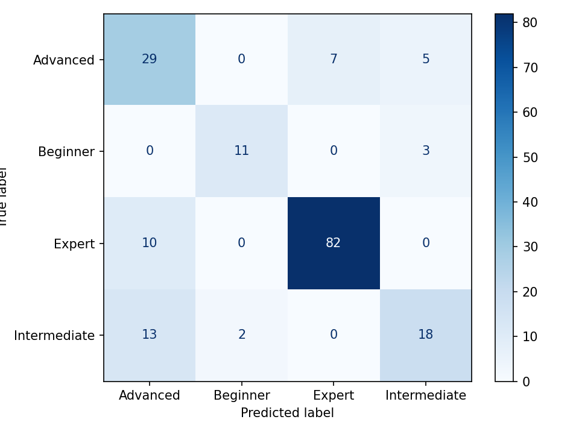
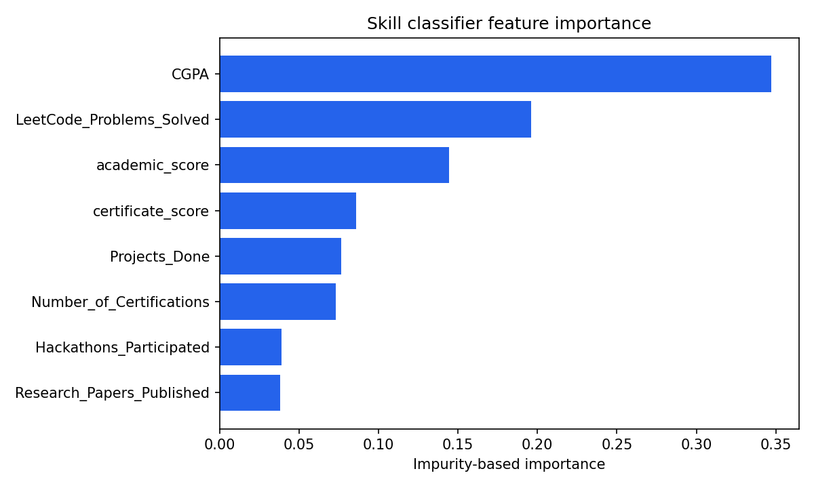
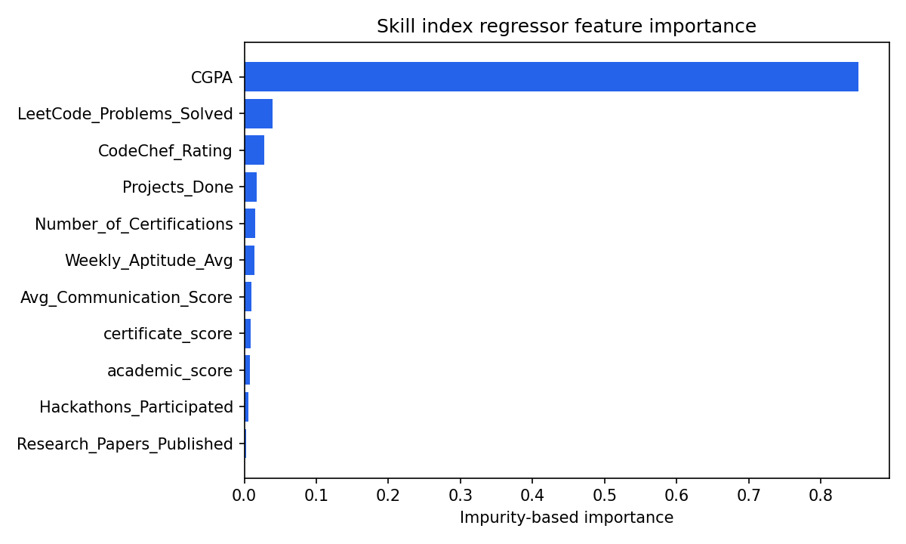

# V2 ML Evaluation Report

## Dataset

This run used **900 synthetic rows**, generated with reproducible correlated distributions from the read-only source schema. CGPA, project work, coding practice, aptitude, and certifications are combined with independent noise to create non-random targets. It is not institutional data.

## Held-out evaluation

All values below came from 20% held-out test splits in `metrics.json`.

| Model | Metrics |
|---|---|
| Skill classifier | Accuracy 0.7778; macro precision 0.7544; macro recall 0.7324; macro F1 0.7387 |
| Skill-index regressor | R² 0.8223; MAE 5.7659; RMSE 7.7271 |
| Scheme recommender | Accuracy 0.8722; ROC-AUC 0.8947; precision 0.9167; recall 0.9098 |

## Plots

## Limitations

This pipeline was trained on synthetic data. It must be retrained and independently validated on representative, consented real institutional data before it is used for actual student evaluation, selection, or recommendations. Feature importances indicate model associations, not causes.
